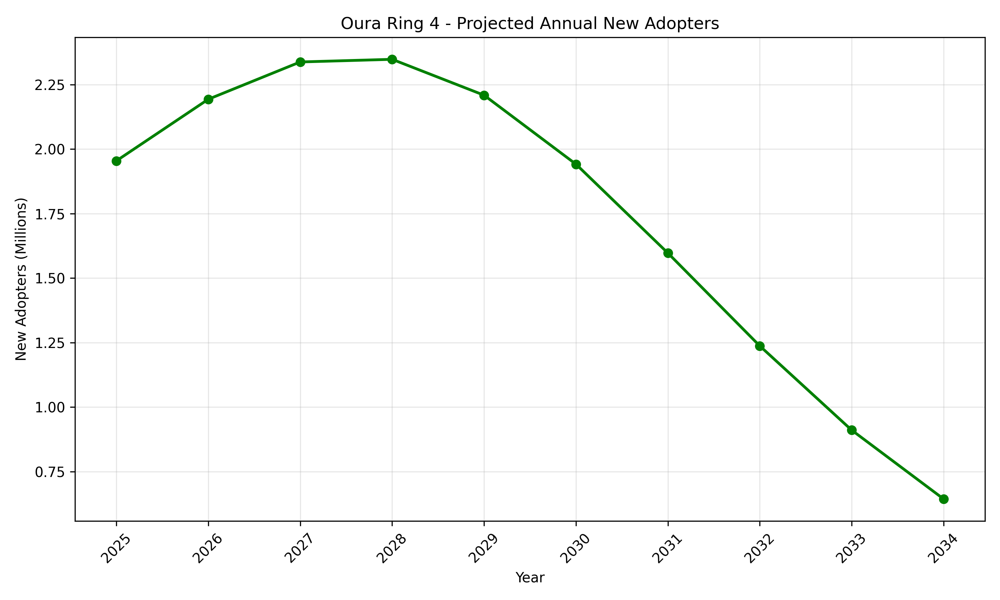
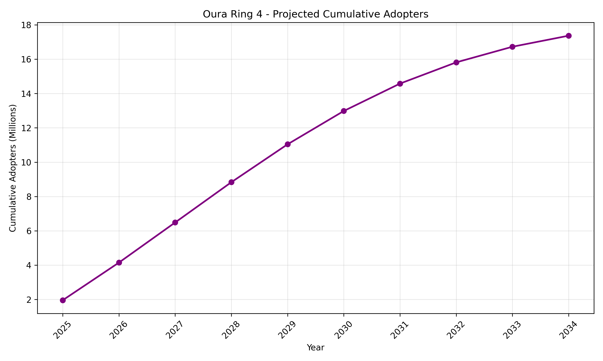

# Homework 1: Bass Diffusion Model

**Predicting the Diffusion of Oura Ring 4 Using Historical Fitbit Data**

## 1. Selected Innovation: Oura Ring 4

The selected innovation is **Oura Ring 4**, which was included in TIME magazine's *Best Inventions of 2025* list. Although it was introduced in October 2024, it was recognized by TIME in 2025.

Oura Ring 4 is a wearable smart ring designed to continuously monitor different aspects of personal health, including heart rate, sleep, body temperature variations, and physical activity. Its sensors collect physiological data that are analyzed to provide users with insights about their health and well-being (Oura, 2024).

## 2. Historical Look-Alike Innovation: Fitbit Fitness Trackers

Oura Ring 4 can be compared with earlier Fitbit fitness trackers because both innovations belong to the wearable health technology market. Fitbit devices were developed to help consumers monitor daily physical activity and personal health. Earlier Fitbit trackers measured steps, distance traveled, calories burned, and sleep patterns. More advanced models also measured heart rate. Similarly, Oura Ring 4 continuously monitors physiological signals and provides personalized health information. Although Fitbit trackers are primarily worn on the wrist or attached to clothing, whereas Oura Ring 4 is worn on a finger, both products use wearable sensors and software to help consumers understand their health (Oura, 2024).

Fitbit fitness trackers are a useful historical comparison because their earlier market growth provides observable evidence of consumer adoption of wearable health-monitoring technology. Historical Fitbit device sales data are available through Business of Apps, making it possible to examine how demand for wearable health-monitoring devices changed over time. However, the products are not identical: they differ in their form factors, features, target consumers, and business models. Furthermore, device sales do not necessarily represent unique first-time adopters because customers may purchase replacement devices. Therefore, Fitbit's historical diffusion pattern will be used as an approximate reference for predicting Oura Ring 4 adoption, rather than assuming that both products will follow exactly the same growth path.

## 3. Historical Data and Scope

This study uses Fitbit annual device sales data from 2014 to 2025, obtained from Business of Apps. The dataset consists of 12 annual observations measured in millions of devices sold.

The geographical scope of the analysis is **worldwide**. A global approach was selected because both Fitbit and Oura operate in international wearable-technology markets. Additionally, the historical dataset and the smart-ring market estimates used in the forecast concern worldwide activity. Using a global scope allows the historical and forecast markets to be compared at a similar geographical level.

The historical Fitbit sales data are analyzed as a proxy for innovation adoption, rather than as a direct measure of unique first-time adopters.

## 4. Bass Model Estimation

The Bass Diffusion Model was applied to Fitbit's historical device sales to estimate three parameters:

- **p:** Coefficient of innovation
- **q:** Coefficient of imitation
- **M:** Total market potential

The discrete-time Bass Model is expressed as:

$$
N_t = \left(p + q\frac{A_{t-1}}{M}\right)(M-A_{t-1})
$$

where:

- **N_t** represents new adopters during year t.
- **A_(t-1)** represents cumulative adopters at the end of the preceding year.
- **p** represents the coefficient of innovation.
- **q** represents the coefficient of imitation.
- **M** represents the total potential market.

The parameters were estimated in Python using nonlinear least squares through the SciPy optimization library. The model minimizes the squared differences between the observed annual Fitbit device sales and the Bass Model predictions.

For simplicity, cumulative adoption was initialized at zero in 2014, the first year of the available dataset. Since Fitbit was already operating before 2014, this represents a modeling assumption rather than the actual beginning of Fitbit adoption.

### 4.1. Estimated Parameters

| Parameter | Estimated Value |
|---|---:|
| Coefficient of innovation (p) | 0.1047 |
| Coefficient of imitation (q) | 0.2534 |
| Fitbit market potential (M) | 160.19 million |

The estimated imitation coefficient exceeds the innovation coefficient, indicating that the fitted model assigns a stronger role to adoption influenced by previous adopters than to independent adoption.

### 4.2. Model Performance

The fitted Bass Model was compared with the historical Fitbit sales observations.

The following performance measures were obtained:

| Metric | Value |
|---|---:|
| RMSE | 3.1897 million devices |
| R² | 0.7740 |

The R² value indicates that the fitted model explains approximately 77.4% of the variation in annual Fitbit device sales within the observed dataset.

However, the model does not perfectly reproduce the fluctuations in sales, particularly around the peak and subsequent decline. The results should therefore be treated as approximate estimates. Additionally, these performance measures describe the fit to the historical data and do not establish the accuracy of future Oura Ring 4 predictions.

## 5. Predicting the Diffusion of Oura Ring 4

### 5.1. Global Market Potential Estimation

To predict the diffusion of Oura Ring 4, the Bass Model parameters estimated from Fitbit's historical data were transferred to the new innovation. However, the market potential parameter was adjusted to account for differences between the historical Fitbit market and the modern smart-ring market.

According to Omdia (2025), worldwide smart-ring shipments were forecast to exceed 4 million units in 2025. Oura accounted for approximately 74% of global smart-ring shipments during the first half of 2025.

Using these figures, we construct a Fermi-style estimate of the potential market for Oura Ring 4.

The estimated annual shipment scale associated with Oura is:

$$
4.0 \times 0.74 = 2.96 \text{ million devices}
$$

This calculation uses 4 million devices as an approximate annual shipment baseline and assumes that Oura's first-half market share is representative of the full year. It is an approximation, not an observed number of Ring 4 adopters.

The adjusted market potential is estimated by scaling Fitbit's fitted market potential according to the ratio between Oura's estimated annual shipment scale and Fitbit's peak reported annual sales.

The formula is:

$$
M_{\text{Oura}} = M_{\text{Fitbit}} \times \frac{2.96}{25.4}
$$

Substituting the estimated values:

$$
M_{\text{Oura}} = 160.19 \times \frac{2.96}{25.4}
$$

$$
M_{\text{Oura}} \approx 18.67 \text{ million}
$$

Therefore, the estimated global market potential for Oura Ring 4 is approximately **18.67 million adopters** under this scenario.

This scaling is a simplified modeling assumption. Since shipment volumes are not equivalent to cumulative unique adopters, the resulting market potential should be interpreted as an illustrative estimate rather than an independently observed market size.

### 5.2. Bass Model Forecast

Using the estimated Fitbit diffusion coefficients and the adjusted Oura market potential, a ten-year adoption forecast was produced for 2025–2034.

The forecast applies the discrete-time Bass Model to estimate both annual new adopters and cumulative adopters.

The estimated parameters used for the Oura forecast are:

| Parameter | Value |
|---|---:|
| Coefficient of innovation (p) | 0.1047 |
| Coefficient of imitation (q) | 0.2534 |
| Adjusted market potential (M) | 18.67 million |

The forecast begins in 2025 and assumes zero cumulative adoption at the beginning of that year for modeling purposes. Because Ring 4 was launched in 2024, this is a simplifying assumption rather than a description of its actual adoption history.

### 5.3. Predicted Number of Adopters

The following table presents the estimated worldwide adoption of Oura Ring 4.

| Year | New Adopters (Millions) | Cumulative Adopters (Millions) |
|---|---:|---:|
| 2025 | 1.954 | 1.954 |
| 2026 | 2.193 | 4.147 |
| 2027 | 2.338 | 6.485 |
| 2028 | 2.348 | 8.833 |
| 2029 | 2.209 | 11.042 |
| 2030 | 1.941 | 12.983 |
| 2031 | 1.597 | 14.580 |
| 2032 | 1.237 | 15.817 |
| 2033 | 0.910 | 16.727 |
| 2034 | 0.644 | 17.371 |

The model predicts that annual adoption will increase from approximately 1.95 million in 2025 to a peak of approximately 2.35 million in 2028.

After 2028, annual adoption is expected to decrease gradually as the estimated potential market becomes increasingly saturated.

By 2034, the model predicts approximately **17.37 million cumulative adopters**, approaching the estimated market potential of 18.67 million.

### 5.4. Adoption Forecast Visualizations

**Figure 1. Projected Annual New Adopters of Oura Ring 4**

The annual adoption curve initially rises and then declines after reaching its peak in 2028, following the characteristic pattern of innovation diffusion.

**Figure 2. Projected Cumulative Adopters of Oura Ring 4**

The cumulative adoption curve increases throughout the forecast period but gradually approaches the estimated market potential.

These projections illustrate a hypothetical long-term diffusion scenario. They do not represent actual Ring 4 sales or verified adoption counts. The model assumes that the adoption dynamics of Fitbit fitness trackers can approximate those of Oura smart rings, despite differences in technology, pricing, competition, and product replacement cycles.

The forecast also treats Ring 4 as a continuing innovation category across the projection period, rather than accounting for future Oura hardware generations.

## 6. Limitations of the Analysis

Although the Bass Diffusion Model provides a useful framework for predicting the adoption of Oura Ring 4, several limitations should be considered.

First, the historical Fitbit sales data were obtained from Business of Apps, a secondary data source. Some reported figures may contain inconsistencies, and not all observations were independently verified. Furthermore, annual device sales do not necessarily represent unique new adopters, because existing customers may purchase replacement devices or additional products.

Second, the available dataset begins in 2014, although Fitbit products were already on the market before that year. The model assumes zero cumulative adoption at the beginning of the observed period, which may introduce bias into the estimated parameters.

Third, Fitbit fitness trackers and Oura Ring 4 have different product designs, prices, target audiences, and competitive environments. Therefore, their diffusion patterns may differ significantly.

Fourth, the estimated market potential of 18.67 million was calculated using a simplified Fermi-style approximation. It depends on assumptions about the global smart-ring market and Oura's market share. The estimate should not be interpreted as an officially reported market size.

Fifth, the forecast begins in 2025 and does not separately account for Ring 4's adoption during the final months of 2024. It also assumes that the estimated Fitbit diffusion parameters remain applicable to Oura.

Finally, the Bass Model assumes a fixed potential market and constant diffusion coefficients. It does not explicitly account for changes in prices, competing technologies, economic conditions, or future product generations.

For these reasons, the results should be interpreted as an illustrative adoption scenario rather than a precise forecast of actual product sales.

## 7. Conclusion

This study applied the Bass Diffusion Model to investigate the potential worldwide diffusion of Oura Ring 4, using historical Fitbit device sales from 2014 to 2025 as a reference.

The model parameters were estimated using nonlinear least squares in Python. The fitted model achieved an R² of 0.7740 and an RMSE of 3.1897 million devices, indicating a reasonable but imperfect fit to the historical data.

A simplified global market-potential estimate of approximately 18.67 million adopters was developed using smart-ring market statistics and a Fermi-style scaling approach.

The resulting forecast suggests that annual Oura Ring 4 adoption could peak in 2028 at approximately 2.35 million new adopters. By 2034, cumulative adoption is projected to reach approximately 17.37 million under the model's assumptions.

Overall, the analysis demonstrates how historical diffusion patterns can be used to construct forecasts for newer innovations. However, the reliability of the predictions depends strongly on data quality, the estimated market potential, and the assumption that Fitbit's historical adoption dynamics are applicable to Oura Ring 4.

The analysis shows that the Bass Model can provide a structured approach to forecasting innovation diffusion, while also highlighting the importance of clearly documenting data limitations and modeling assumptions.